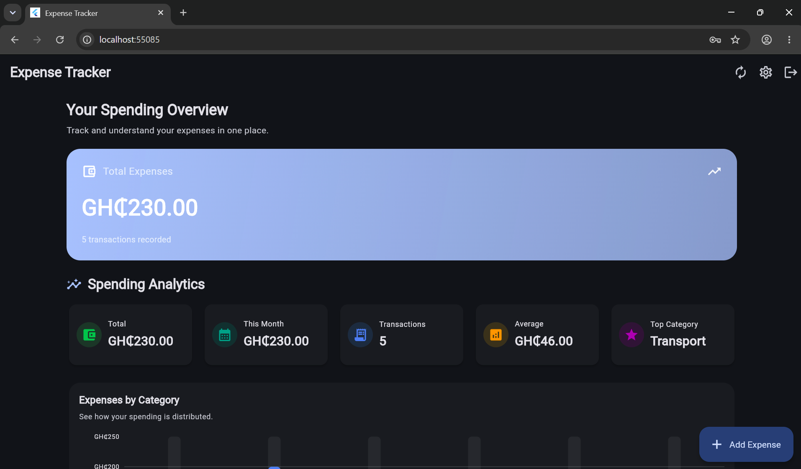
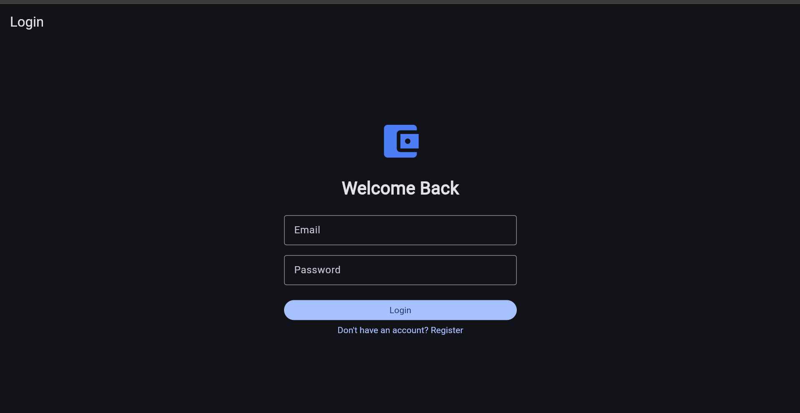
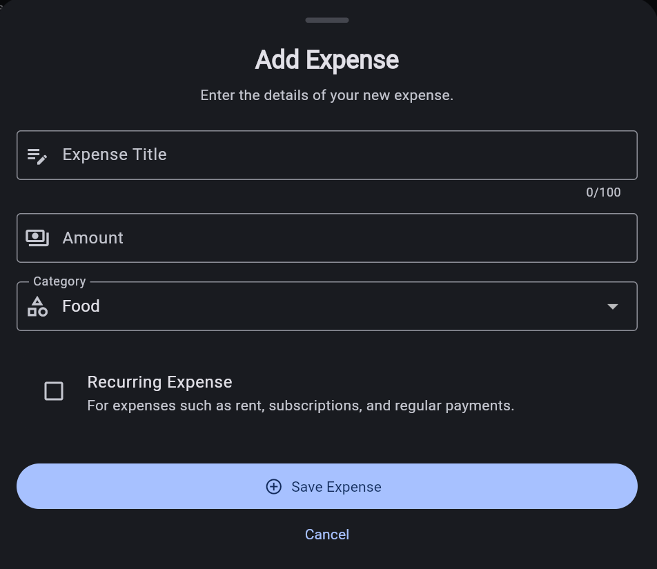
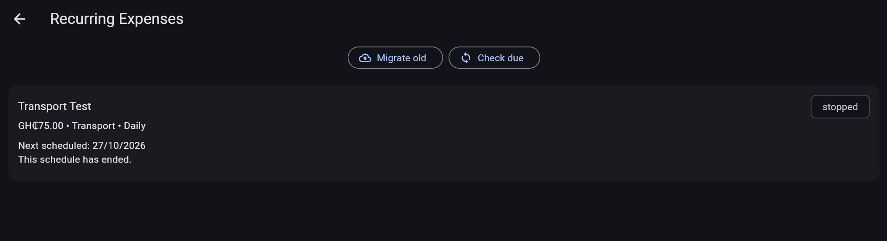
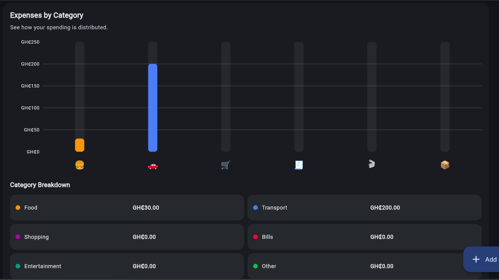
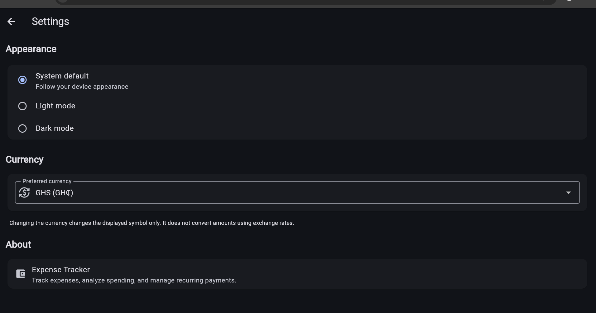

# Expense Tracker

A personal finance management application built with Flutter and Firebase.

Expense Tracker helps users record daily expenses, monitor spending patterns, manage recurring payments, and export financial records.

## Features

- User registration and login with Firebase Authentication
- Secure, user-specific expense storage in Cloud Firestore
- Add, edit, and delete expenses
- Search, filter, and sort expenses
- Spending statistics and visual charts
- Recurring expense management
- Light, dark, and system appearance modes
- Multiple display currency options
- Export expense records to CSV and PDF
- Form validation and loading indicators

## Technologies Used

- Flutter and Dart
- Firebase Authentication
- Cloud Firestore
- SharedPreferences
- PDF and CSV export packages

## Application Architecture

The project organizes its code into:

- `lib/models/` — Expense and recurring schedule data models
- `lib/screens/` — Authentication, dashboard, settings, and expense screens
- `lib/services/` — Firebase, preferences, recurring expenses, and exports
- `lib/widgets/` — Reusable UI components
- `lib/charts/` — Spending visualizations

## Getting Started

### Prerequisites

- Flutter SDK
- Dart SDK
- Firebase project
- Chrome or another supported Flutter target

### Installation

1. Clone the repository:

   ```bash
   git clone https://github.com/fannaremeaboubacarabdougana/expense-tracker.git
   ```

2. Enter the project directory:

   ```bash
   cd expense-tracker
   ```

3. Install dependencies:

   ```bash
   flutter pub get
   ```

4. Configure Firebase for your own project using FlutterFire CLI.

5. Run the application:

   ```bash
   flutter run -d chrome
   ```

## Security

Expense records and recurring schedules are stored under each authenticated user's Firestore document path.

Firestore Security Rules restrict access to the authenticated account owner.

## Currency Note

Changing the preferred currency changes the displayed symbol only. The application does not convert historical amounts using exchange rates.

## Future Improvements

- Budget limits and spending alerts
- More detailed financial reports
- Improved automated testing
- Enhanced responsive layouts
- Optional expense reminders

## Project Status

Functional portfolio project undergoing final testing and documentation.

## Author

Fannareme Aboubacar Abdou Gana

GitHub: https://github.com/fannaremeaboubacarabdougana


## Application Screenshots

### Dashboard


### Login


### Add Expense


### Recurring Expenses


### Spending Statistics


### Settings

